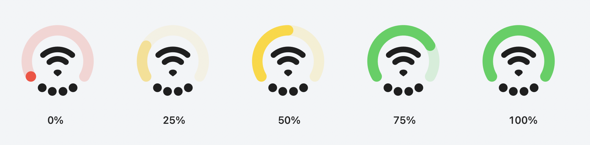
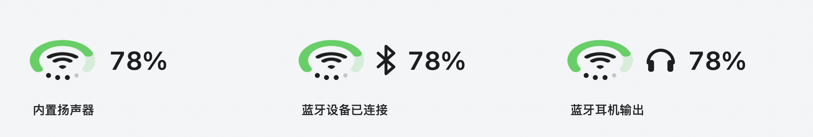

# OrbitBar

[](https://github.com/thomasDJMax/OrbitBar/actions/workflows/ci.yml)

OrbitBar 是一个原生 macOS 菜单栏小工具，将底部开口的电量弧、中心网络标记和沿底部弧线排列的四点音量合在一个图标里。视觉灵感来自 iPhone Duo 风格的组合状态图标；这是独立编写的 Swift 实现，使用自己的名称和图标。

## 下载

在 [GitHub Releases](https://github.com/thomasDJMax/OrbitBar/releases) 下载 `OrbitBar-macos.zip`，解压后打开 `OrbitBar.app`。安装包包含 Apple Silicon 和 Intel 架构，要求 macOS 14 或更新版本。签名与首次运行限制见下方打包说明。

## 功能

- 电量沿顶部与两侧的开口弧线显示电池百分比，底部为音量圆点留出空间；0–24% 为红色，25–49% 为淡黄色，50–74% 为黄色，75–100% 为绿色。
- 中心图标显示 Wi-Fi、有线网络或离线状态；Wi-Fi 使用两条圆角弧线和扇形信号点，弧线体现可读取的信号强度。
- 底部四个圆点沿弧线排列，显示系统输出音量；调整音量时平滑过渡并轻微放大，连续或反向调节会从当前动画进度衔接。菜单栏、状态面板和设置预览共用同一动画进度，并尊重系统的“减少动态效果”设置。
- 左键点击菜单栏图标打开状态面板，查看电量、网络、蓝牙设备、当前输出和音量；支持设备允许的音量调节与静音。
- 区分内置扬声器、有线耳机、蓝牙耳机、蓝牙音频、USB 和显示器音频。耳机作为当前输出时，菜单栏增加耳机标记；蓝牙开启或存在连接设备时显示蓝牙标记，中心 Wi-Fi 图形保留。
- 蓝牙区显示已连接耳机、鼠标、键盘等设备，匹配到当前音频输出时标记“正在使用”。系统提供电量时显示总电量或左右耳、充电盒读数；连接后显示“正在读取电量”，重连后的旧缓存标记“上次报告”，未提供的值保持未知。当前耳机的电量也显示在音频输出名称下方。
- 电池详情可显示剩余时间、健康度与循环次数，具体项目取决于硬件提供的信息。
- 外观设置包括电量配色开关、百分比文字、图标宽度和电量弧粗细，并会保存到本机。菜单栏高度固定，宽度范围为 65–160%，默认 160%；采用更大的 Wi-Fi、音量点，旁边提供与实际菜单栏绘制一致的实时预览。升级保留用户原有宽度和粗细；异常设置值会采用安全默认值或限制到有效范围。
- 支持登录时启动，以及电池、网络、声音、蓝牙系统设置的快捷入口。
- 右键点击可查看状态或退出；状态面板底部也提供退出按钮。
- 原生 AppKit 菜单栏入口与 SwiftUI 面板；应用本身不占用 Dock。

## 环境要求

- macOS 14 Sonoma 或更新版本。
- Swift 6，以及 Xcode 或 Xcode Command Line Tools。
- 当前机器架构即可构建；通用构建包含 Apple Silicon 和 Intel 两种架构。

## 开发运行

在项目目录执行：

```bash
swift run OrbitBar
```

开发运行时，macOS 可能将菜单栏项目归属到启动它的终端或开发工具。日常使用建议先打包，再从 Finder 打开应用。

“登录时启动”通过 macOS 的登录项服务注册，需要在打包后的 `.app` 中使用。若系统要求批准，应用会提示进入“系统设置 → 通用 → 登录项”。

运行核心逻辑测试：

```bash
swift test
bash scripts/test-settings.sh
bash scripts/test-bluetooth-bridge.sh
python3 scripts/test-build-transaction.py
```

设置回归编译真实设置对象，使用独立测试偏好域和登录服务替身。蓝牙回调回归编译真实输出桥接对象，检查 Combine 发布前后时序、快速切换和回调重入。发布回归在临时项目中模拟构建失败与进程被终止，构建工具由测试替身提供，需要 Python 3。

## 打包成 Mac 应用

```bash
bash scripts/build-app.sh
```

脚本会构建 Release 可执行文件，生成原创应用图标，组装 `dist/OrbitBar.app`，进行本地 ad-hoc 签名，并生成 `dist/OrbitBar-macos.zip`。它不会将应用安装到 `/Applications`，也不会自动启动应用。

重新构建前，先退出正在运行的 `dist/OrbitBar.app`。脚本会在临时目录完成新应用与 ZIP 的校验，再替换上一版；构建或校验失败会保留已有产物。同一目录的竞争构建会被拒绝；发布中途被强制终止后，下次调用会先恢复中断的事务。

需要同时包含两种 CPU 架构时执行：

```bash
bash scripts/build-app.sh --universal
```

在 Finder 中进入 `dist` 目录，双击 `OrbitBar.app` 即可运行。可以自行将它拖到“应用程序”目录。退出可在应用的状态面板中完成。

首次启动会自动打开状态面板，之后可点击菜单栏图标或再次双击应用打开面板。请先将应用放到固定位置，再启用“登录时启动”。

本地构建使用 ad-hoc 签名，未经过 Apple 公证。跨机器传递的 ZIP 可能受到 macOS Gatekeeper 的检查；正式发布需要开发者签名与公证。

## 数据与限制

状态信息通过 macOS 系统 API 在本机读取；应用没有服务器，不上传用户数据。

电池详情取决于设备提供的信息；没有内置电池的 Mac 会显示供电状态。Wi-Fi 名称可能因 macOS 的隐私限制而不可用，连接状态仍可显示。音量调节取决于输出设备是否支持系统软件音量控制，HDMI、部分 USB 或数字音频设备可能由硬件控制。

首次使用蓝牙区，点击“允许显示蓝牙设备”，再按 macOS 提示决定是否允许。未决定或拒绝访问时，面板会显示对应状态；拒绝后可打开蓝牙权限设置。应用只观察现有连接，不主动扫描、配对、连接设备或切换蓝牙开关。

蓝牙设备电量取决于系统已经发布的设备属性。公开蓝牙接口没有适用于所有耳机的左右耳／充电盒电量读取方法，本项目通过公开 IOKit 函数读取可用的注册表电量；某些设备或系统版本可能完全不提供这些值。BLE 鼠标、键盘等通过已有 Bluetooth HID 服务补充，不能保证覆盖所有 BLE 配件。

连接、断开和当前音频输出变化会触发立即更新与有限次数的短重读；60 秒轮询只作兜底。明确断开通知会先移除旧设备，即使系统缓存尚未清除。重连后同一电量来源的未变化缓存显示为“上次报告”，新的来源或本次连接内读数变化后才恢复为当前读数；应用无法让未报告电量的耳机主动提供电量。

最低系统版本声明为 macOS 14。兼容性仍需在不同 macOS 版本、CPU 和音频设备上验证；本项目的本机验证结果以实际构建与运行记录为准。

## 当前验证

1.2.3（2026-10-14）在 Apple Silicon、macOS 27.0.1 上的验证记录：

- `swift test`：128 项核心测试全部通过，覆盖无地址 UID 的耳机断开与同名设备切换、睡眠／关开蓝牙后的旧监听回调、唤醒通知乱序、多电量来源连续更新与重连隔离，以及原有输出控制、配色、动画、电池和外观偏好。
- `bash scripts/test-bluetooth-bridge.sh`：真实桥接对象回归通过，覆盖 `@Published` 状态提交顺序、快速连续切换、最新元数据、过期路由、停止及回调重入。
- 1.2.2 已通过的真实设置对象回归和 11 项发布故障测试保留在 CI 中；设置和发布事务实现本次未改动。
- 通用 Release 构建成功，产物包含 `arm64` 和 `x86_64`；应用签名和 ZIP 完整性校验通过。
- 本机打开 1.2.3 状态面板，确认电池、Wi-Fi、内置扬声器与“允许访问后显示连接设备”状态正常，当前音量 100% 未被修改；原有 110% 宽度、2.15 pt 粗细及配色／百分比开关保留。本轮无实体耳机，耳机连接／断开和左右耳／盒读数使用时序与数据回归验证。[新版实机面板截图](previews/bluetooth-panel-1.2.3.jpg)
- `.github/workflows/ci.yml` 在 GitHub 推送和 pull request 时执行核心测试、设置回归、蓝牙回调回归、发布故障测试、通用构建与脚本语法检查。[查看远程验证结果](https://github.com/thomasDJMax/OrbitBar/actions/workflows/ci.yml)

Intel 架构已编译，尚未在 Intel 机器上运行验证。蓝牙授权后的设备连接／断开、左右耳／盒电量、登录项注册、睡眠唤醒、低电量模式及不同音频硬件仍需相应环境实测。

## 1.2.3 连接与电量更新修复

- 修复 UID 不包含蓝牙地址的耳机断开后，旧输出控件和音量圆点仍然保留的问题。已可靠匹配的耳机与完整 HAL 路由关联，明确断开立即禁用旧路由；实际切换设备后重新建立关联。
- 已关联的旧路由不会因为 A 离开列表就转交给同名 B，避免错误的“正在使用”标记和电量。列表缺席、访问权限不足本身仍不被当成断开证据。
- 音量和静音写入前使用实时读取的完整路由校验这项关联，防止断开事件已到达、HAL 尚未切换时的延迟操作。
- 同一设备的电量来源逐个观察，每个来源保留完整读数。优先选择本次连接内最近发生实际读数变化的来源，修复低优先来源更新后仍长期显示另一个旧值的问题；重复读数和名称变化不会提高来源优先级。
- 重连后仍未确认的旧来源保留“上次报告”标记。新来源或更新后的部分／无效读数整体传播，不从其他来源拼接左右耳和盒电量。
- 注册表读取在单次批次内共享相同服务的属性快照，减少重复读取，并防止同一来源被多个子服务重复观察。
- 每轮原生蓝牙监听携带固定批次标记。睡眠、蓝牙／权限不可用或注销监听后，旧回调即使延迟到唤醒或重新开启时执行也会被拒绝。
- 睡眠／唤醒事件按原始通知时间处理，防止旧睡眠任务晚到再次停止更新；唤醒主动重建监听和读取任务。

## 1.2.2 发布检查修复

- 修复自动恢复连接后延迟的旧断开通知再次清除新会话的问题；经典蓝牙和新 HID 服务恢复时记录本次观察时间，拒绝旧会话通知。
- 推断出的恢复不获得额外连接确认宽限；普通连接读数不推进会话边界，真实断开通知仍能正常处理。
- 新增三项回归，覆盖经典蓝牙恢复、新 HID 服务恢复及普通读数不能吞掉真实断开事件。

## 1.2.1 蓝牙与输出切换修复

- 显式断开立即移除设备，并阻止尚未更新的经典蓝牙连接标记或旧 HID 服务将设备重新加入。已确认的经典连接随后明确返回断开时，即使通知漏失，也隔离旧 HID 和电量来源；初始未连接读数不会误删 BLE HID 设备。每次连接和注册表读取使用独立版本；取消或过期的异步读数不能覆盖当前状态。
- 连接通知先于系统 getter 时给予 5 秒确认宽限，并在 0.3、0.8、1.6、3.2、5.2 秒重读。未获确认时撤销连接状态；乱序到达的旧连接／断开事件被忽略。
- 当前音频输出变化触发蓝牙短重读；蓝牙连接成员变化触发立即音频读取及 0.15、0.5、1.2 秒重读。连续切换取消上一组重试，电量更新不会反复触发音频查询。
- 明确断开已匹配耳机或关闭蓝牙时，旧音频路线的控件暂时禁用、音量圆点清空；音量／静音写入前再次核对真实路线和断开证据，防止延迟拖动操作写入失效设备。
- 设备地址优先于名称匹配。只有完整地址标记被视为 UID 地址证据；名称回退要求精确且唯一，避免同名耳机或 UUID 片段串线。读取注册表中的六字节地址时，仅采用与已确认连接地址一致的唯一字节序。
- 电量只使用同一已确认设备、同一完整来源的读数；部分或无效读数不从其他父节点／服务拼接。真实 0% 保留，255、负数、布尔值及异常数据保持未知。
- 重连后先显示读取状态，旧来源缓存标记“上次报告”；只有本次连接内的电量变化或新来源能将其确认为当前读数。IOKit 属性变化触发后台更新，名称变化不会使旧电量冒充新电量。
- 跨监视器回调延后到 `@Published` 状态提交之后，连续切换只使用当前路线，避免发布过程中重入导致状态回退。

## 1.2.0 修复与优化

- 修复外观滑块在 `@Published didSet` 内递归赋值导致的卡住或崩溃，并加入真实对象运行回归。
- 音量／静音写入前校验设备 ID、持久 UID 和当前输出路径；拖动中换设备、插拔同设备耳机或设备 ID 重用时，旧操作不会写到新输出。面板或滑块退出时清理拖动状态。
- 新增设备存活、输出列表、数据源、耳机插孔和输出流变化监听。音量固定但允许硬件静音的设备仍可使用静音按钮。
- 蓝牙连接事件合并更新，60 秒低频兜底；电量注册表查询在后台进行，睡眠及退出时取消工作和监听。
- 多设备与外观设置统一滚动；面板高度按实际内容收缩，打开面板及屏幕变化时按菜单栏所在屏幕限制高度。
- 单实例锁明确区分锁冲突和系统错误，重复启动可唤醒已有面板；登录项操作失败的提示不会被被动刷新吞掉。
- 发布加入互斥锁和可恢复事务，处理进程被强制终止或清理中断后应用与 ZIP 不一致的问题。

- 统一音量动画时钟，保留当前进度和速度；动画结束即停止计时器，低电量模式下使用较低帧率，睡眠时停止动画及周期采集。
- 缓存电池与网络图形，动画帧只更新音量点；音频通知合并处理，调音量时不重复读取电池和网络，电池健康数据降低查询频率。
- 切换输出设备或声道布局时清除旧的静音恢复状态；多声道写入部分失败时尝试回滚已写入声道，软件静音状态仅在写入成功后保存。
- 外观设置立即生效，存储延迟 250 毫秒合并连续修改，正常退出时写入最后一次变更。
- 使用干净的临时应用包生成签名和 ZIP，完成校验后再发布，避免旧资源残留和覆盖运行中的可执行文件。

## 图形预览

菜单栏宽度可调到 160%，详情主图标为 96 pt，面板宽度为 420 pt。

以下图形使用应用的绘图代码生成；动画由应用实际使用的动画模型采样，展示逐步增加音量、快速反向调节与静音，非屏幕录制。



下面三种状态使用模拟设备数据及应用的原生菜单栏绘图代码生成。




重新生成预览：

```bash
bash scripts/render-preview.sh
```

## 源码结构

- `Sources/OrbitBar`：菜单栏入口、原生绘图、音频／网络／电池／蓝牙采集、共享动画控制器和界面。
- `Sources/OrbitBarCore`：状态归一化、配色、声道平衡、音频分类及路由保护、蓝牙状态与匹配、外观偏好和连续动画模型。
- `Tests/OrbitBarCoreTests`：核心逻辑测试。
- `Resources/Info.plist`：应用信息与菜单栏模式声明。
- `scripts/build-app.sh`：构建、图标生成、签名和 ZIP 打包。
- `scripts/render-preview.sh`：从应用绘图与动画代码生成开发预览。
- `scripts/test-settings.sh`：真实设置对象的隔离运行回归。
- `scripts/test-bluetooth-bridge.sh`：真实蓝牙输出桥接对象的发布顺序、取消与重入回归。
- `scripts/test-build-transaction.py`：临时项目中的发布故障注入与恢复检查。
- `.github/workflows/ci.yml`：macOS 核心测试与通用构建检查。

## 许可

MIT，详见 [LICENSE](LICENSE)。
